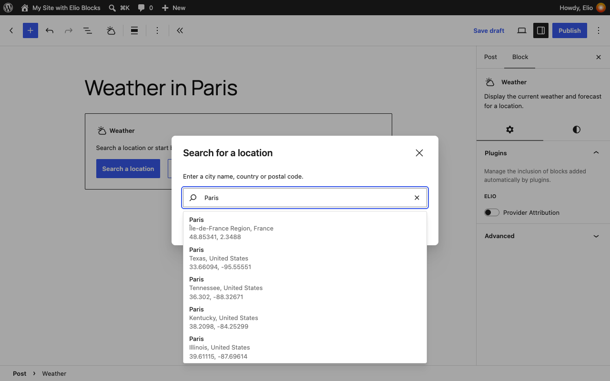
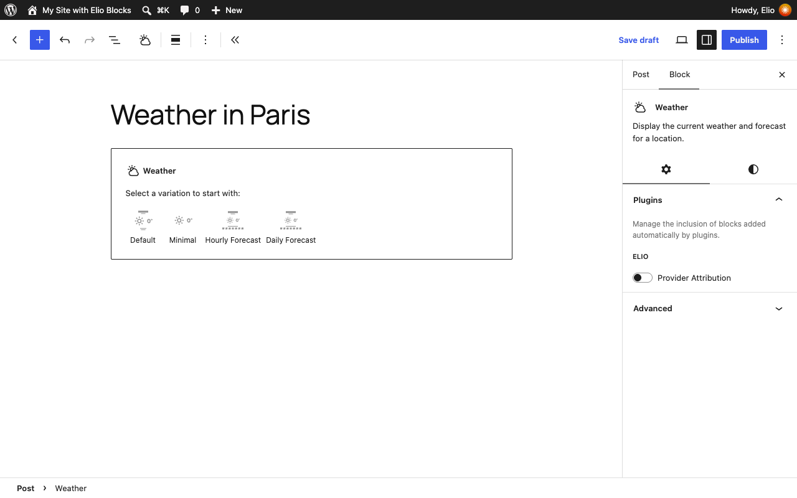
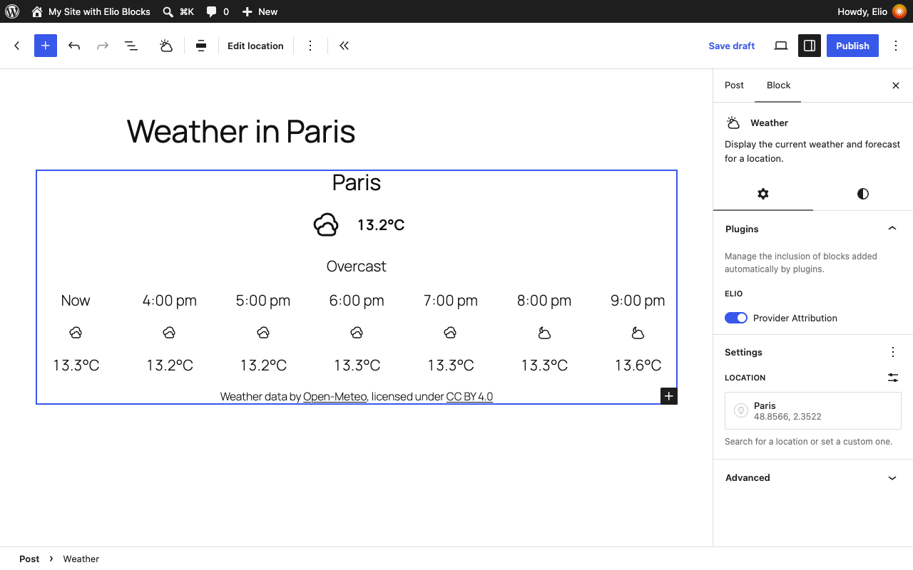
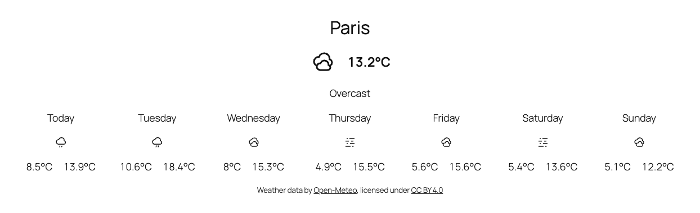

## Install the plugin

In the WordPress admin, visit **Plugins > Add New**, search for **Elio Blocks**, then install and activate it. Or upload the `elio-blocks` folder to `wp-content/plugins/` and activate it from **Plugins**.

## Add a Weather block

1. In the Block Editor, insert the **Weather** block.
2. Search for a location by name, or enter its coordinates. The editor shows its live weather right away.
3. Pick a layout: **Default**, **Minimal**, **Hourly Forecast** or **Daily Forecast**. Or start blank and build your own.

The Weather block holds the blocks that show the data. Add, remove, reorder and nest them like any other block, from the canvas or the List View: each of them reads the location, provider and units of the Weather block around it. The [blocks reference](reference/blocks.md) lists them all.

## Forecasts

The **Forecast** block shows the hourly or daily forecast of its Weather block. It repeats its **Forecast Template** once per hour or day: design one row, with the blocks you want in it (date, temperature, condition icon…), and every row follows. The list starts at the hour or the day in progress, and moves on as time goes by.

## Design

The blocks use the standard design tools of WordPress: colors, typography, spacing, borders and layout appear in the same panels as those of core blocks, follow the presets of your theme, and can be set for the whole site in `theme.json` or the Styles of the Site Editor.

Dates and times are written in the language and the date formats of your site, in the timezone of the location. Units are metric or imperial, for the whole site ([Settings](settings.md)) or for one Weather block.

## Credit the data

The **Provider Attribution** block prints the credit the license of the weather data asks for ("Weather data by Open-Meteo, licensed under CC BY 4.0"). It is added at the bottom of each Weather block: keep it, or credit the provider elsewhere on the page.
