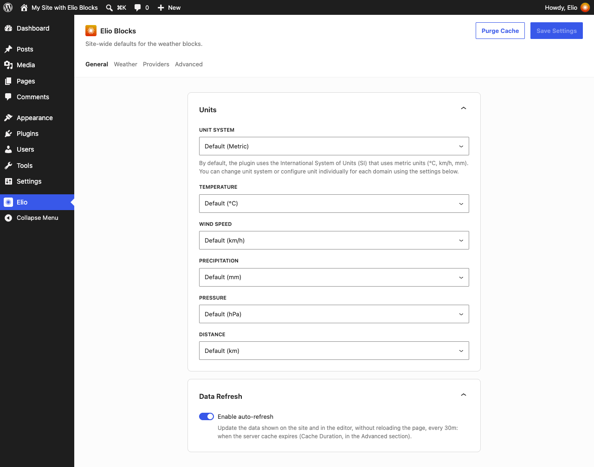
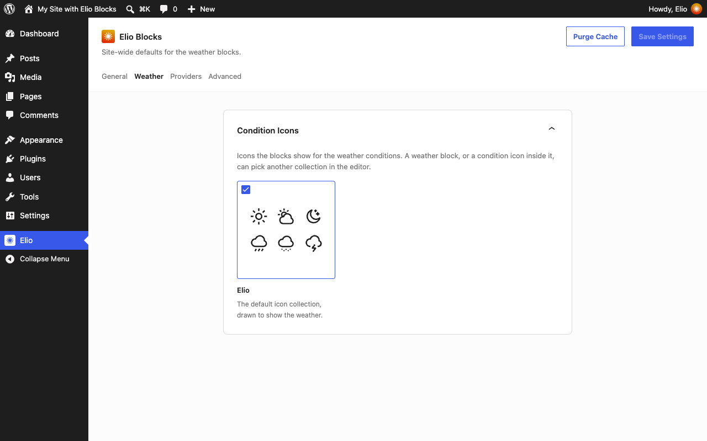
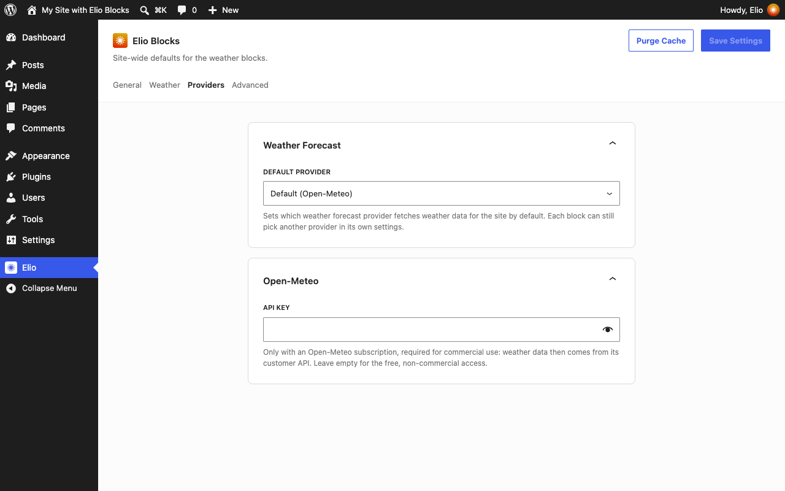
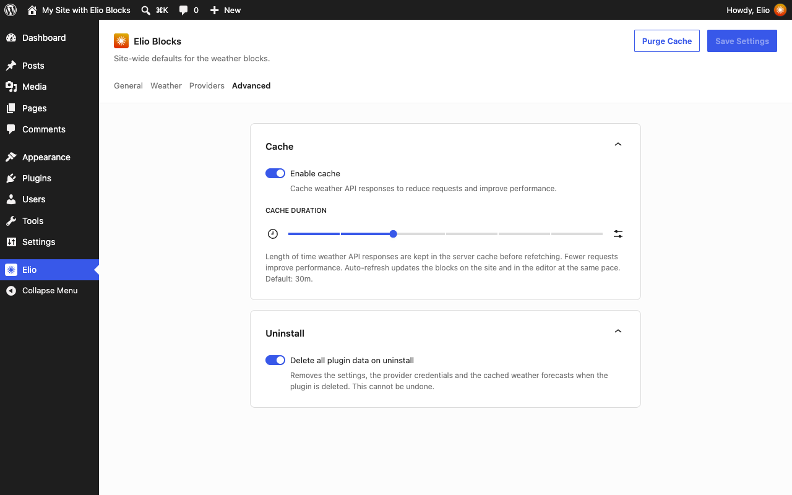

The settings of the plugin are under **Elio** in the admin menu. They apply to the whole site; a Weather block can choose its own units, provider and icon collection.

## General

- **Units**: the unit system (metric or imperial), and for each kind of value the unit it is shown in: temperature, wind speed (km/h, mph, m/s, knots, Beaufort), precipitation, pressure and distance.


- **Data refresh**: whether the weather shown in an open page updates itself, and how often while the cache is off. With the cache on, the data is refreshed when the cached copy expires.

## Weather

- **Condition icons**: the icon collection of the site, the one a Weather block shows unless it chooses another. Each collection is previewed by six of its icons.



## Providers

- **Weather forecast**: the default provider, the one a Weather block asks unless it chooses another.
- One card per provider, with the credentials it asks for. Open-Meteo needs none for non-commercial use; for commercial use, enter the API key of an Open-Meteo subscription in its card.



A credential can also be set in `wp-config.php`, with the constant `ELIO_BLOCKS_{SLUG}_{NAME}` (uppercased, hyphens as underscores):

```php
define( 'ELIO_BLOCKS_OPEN_METEO_API_KEY', 'your-api-key' );
```

## Advanced

- **Cache**: weather forecasts and location searches are kept in transients, 30 minutes by default, so the provider is only asked again once the copy has expired.
- **Uninstall**: whether deleting the plugin also deletes its settings, the credentials of the providers and the cached data.


